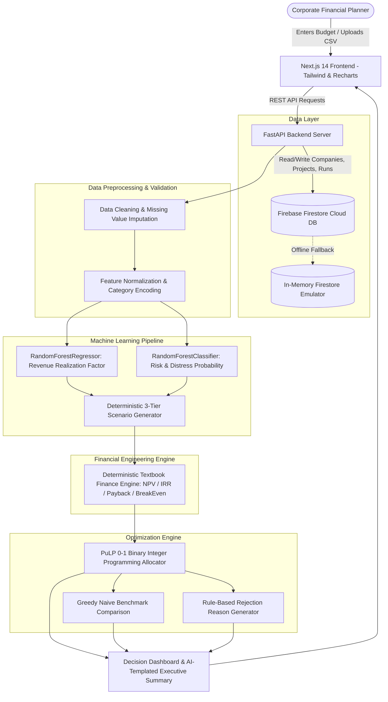

# VentureLens AI — Multi-Project Capital Allocation Advisor
> **FFM CIE-2 Academic Project** | Next.js · FastAPI · Firebase Firestore · PuLP 0-1 Optimization · Scikit-Learn Real Data Models

[](https://venturelens-ai.vercel.app)
[](https://github.com/Aryan010N/VentureLens_AI)
[](https://www.kaggle.com/datasets/manishkc06/startup-success-prediction)
[](https://firebase.google.com)

---

## 📌 1. Problem Statement & Corporate Finance Context

In corporate financial management, firms frequently encounter the **Capital Rationing Dilemma**: evaluating proposed capital investments in isolation using simple hurdle rates fails to produce the optimal combination of projects when investment funds are finite. 

A project that appears profitable on a standalone basis might:
1. Exhaust capital required by a more lucrative bundle of complementary initiatives,
2. Breach minimum corporate cash reserve requirements in early deployment years, or
3. Skew aggregate corporate risk beyond executive tolerance.

**VentureLens AI** solves this problem by acting as an end-to-end decision-making system. It combines:
- **Real Historical Machine Learning**: Estimates operational revenue confidence and distress probabilities trained on real startup success data.
- **Deterministic Finance Engine**: Calculates textbook-correct NPV, IRR, Payback, Discounted Payback, Break-Even, and cash reserve breach points.
- **PuLP Mathematical Optimization**: Solves the 0-1 binary integer linear programming problem to maximize portfolio NPV subject to budget caps, risk ceilings, and liquidity reserves, providing clear rule-based rejection justifications for excluded initiatives.

> **Important Disclosure**: ML predictions are estimates based on historical Kaggle startup data, not guaranteed returns. Illustrative spec numbers are used only as UI placeholder values, never as training data.

---

## 📚 2. Full FFM (Foundations of Financial Management) Concept Coverage

| FFM Domain | Specific Concept Implemented in Engine | Implementation Location |
| :--- | :--- | :--- |
| **Capital Budgeting** | Net Present Value ($\text{NPV} = \sum_{t=0}^n \frac{CF_t}{(1+r)^t}$) with hurdle rate discounting | [`backend/finance/engine.py`](backend/finance/engine.py) |
| **Project Rate of Return** | Internal Rate of Return ($\text{IRR}$ where $\text{NPV} = 0$) using `numpy_financial` and Newton-Raphson | [`backend/finance/engine.py`](backend/finance/engine.py) |
| **Capital Recovery** | Linear interpolation Payback Period and Discounted Payback Period | [`backend/finance/engine.py`](backend/finance/engine.py) |
| **Cost-Volume-Profit** | Break-Even Point (Units and Revenue) with Contribution Margin analysis | [`backend/finance/engine.py`](backend/finance/engine.py) |
| **Benefit-Cost Index** | Profitability Index ($\text{PI} = \frac{\text{PV of Future Inflows}}{\text{Initial Outlay}}$) | [`backend/finance/engine.py`](backend/finance/engine.py) |
| **Liquidity & Cash Flow** | Multi-year cash timeline with automatic flagging of minimum cash reserve breaches | [`backend/finance/engine.py`](backend/finance/engine.py) |
| **Sources of Finance** | Capital sourcing breakdown: Internal Equity vs. Loan Facilities, Borrowing Ratio, and Interest Burden | [`backend/finance/engine.py`](backend/finance/engine.py) |
| **Financial Risk & Distress** | Machine learning risk classifier trained on real historical dataset ($P(\text{distress}) = 1 - P(\text{success})$) | [`backend/ml/predict.py`](backend/ml/predict.py) |
| **Cash-Flow Uncertainty** | Machine learning revenue confidence multiplier and deterministic 3-tier scenario analysis | [`backend/ml/predict.py`](backend/ml/predict.py) |
| **Portfolio Capital Allocation** | Binary 0-1 Knapsack Optimization maximizing aggregate NPV under budget and risk limits | [`backend/optimization/allocator.py`](backend/optimization/allocator.py) |

---

## 🏛️ 3. System Architecture



---

## 🗄️ 4. Firebase Firestore Schema

The database is built on **Google Firebase Firestore** (NoSQL collection-document structure). No SQLite or local flat files are used for persistence.

```
firestore-root
│
└── companies/{companyId}
    │   total_budget: number (e.g. 2000000)
    │   min_cash_reserve: number (e.g. 200000)
    │   loan_facility: number (e.g. 500000)
    │   discount_rate: number (e.g. 0.12)
    │   planning_period: number (e.g. 5)
    │   max_risk_level: string ("Low" | "Medium" | "High")
    │   created_at: ISO8601 string
    │
    ├── projects/{projectId}
    │       name: string (e.g. "Solar installation")
    │       initial_cost: number (e.g. 800000)
    │       cash_flows: array<number> [300000, 300000, 300000, 300000, 300000]
    │       risk_category: string ("Low" | "Medium" | "High")
    │       industry_category: string ("CleanTech", "Software", etc.)
    │       duration: number (e.g. 5)
    │       created_at: ISO8601 string
    │
    └── runs/{runId}
            run_id: string
            timestamp: ISO8601 string
            allocated_budget: number
            unallocated_budget: number
            budget_utilization_pct: number
            selected_count: number
            total_projects: number
            total_npv_optimized: number
            total_npv_naive: number
            optimization_uplift_pct: number
            portfolio_risk_score: number
            allocations: array<AllocationItem>
            ai_recommendation: string
            constraints_summary: object
```

---

## 📊 5. Real Dataset Citation & Model Metrics

### Dataset Citation
- **Source**: Kaggle Real Historical Dataset
- **Exact Slug**: [`manishkc06/startup-success-prediction`](https://www.kaggle.com/datasets/manishkc06/startup-success-prediction)
- **Features Used**: `funding_rounds`, `milestones`, `relationships`, `age_last_funding_year`, `avg_participants`, `is_software`, `is_enterprise`, `is_biotech`, `is_ecommerce`
- **Rows**: 923 historical company venture records
- **Train/Test Split**: 80% Train (738 samples) / 20% Held-Out Test (185 samples), stratified on binary outcome.

### Held-Out Test Split Performance Metrics
Computed on 185 unseen test instances and serialized in [`backend/models/metrics.json`](backend/models/metrics.json):

| Model | Target Output | Algorithm | Metric 1 | Metric 2 | Metric 3 | Metric 4 |
| :--- | :--- | :--- | :--- | :--- | :--- | :--- |
| **Revenue Confidence Model** | Cash Flow Multiplier (0.45 – 1.0) | `RandomForestRegressor` | **R²: 0.8678** | **MAE: 0.0437** | **RMSE: 0.0556** | 100 Estimators |
| **Risk / Distress Model** | Probability of Distress ($1 - P(\text{success})$) | `RandomForestClassifier` | **ROC-AUC: 0.8176** | **Accuracy: 77.84%** | **Precision: 80.15%** | **F1: 0.8367** |

---

## 🧮 6. Fully Worked Example (Spec Scenario Verification)

### Company Financial Constraints
- **Available Investment Budget**: ₹20,00,000 (₹20 Lakh)
- **Minimum Cash Reserve**: ₹2,00,000 (₹2 Lakh)
- **Available Loan Facility**: ₹5,00,000 (₹5 Lakh)
- **Cost of Capital (Discount Rate)**: 12%
- **Evaluation Period**: 5 Years
- **Max Acceptable Risk**: Medium

### Candidate Project Proposals
| Project Name | Initial Cost | Expected Annual Inflow (5 Yrs) | Discounted NPV (@ 12%) | IRR | Payback | Assessed Risk |
| :--- | :---: | :---: | :---: | :---: | :---: | :---: |
| **Solar installation** | ₹8,00,000 | ₹3,00,000 | +₹2,81,433 | 24.52% | 2.67 Yrs | Medium |
| **Recycling unit** | ₹6,00,000 | ₹2,50,000 | +₹3,01,194 | 30.54% | 2.40 Yrs | Medium |
| **Software product** | ₹5,00,000 | ₹2,40,000 | +₹3,65,146 | 39.58% | 2.08 Yrs | High |
| **Energy-efficient equipment** | ₹4,00,000 | ₹1,80,000 | +₹2,48,860 | 34.90% | 2.22 Yrs | Low |

### PuLP Mathematical Optimization Outcome
```
Maximize:   281,433 * x_Solar + 301,194 * x_Recycling + 365,146 * x_Software + 248,860 * x_Energy
Subject to: 800,000 * x_Solar + 600,000 * x_Recycling + 500,000 * x_Software + 400,000 * x_Energy <= 2,000,000
            x_i in {0, 1}
```

#### Optimization Result:
- **Projects Selected**: **3 of 4** (`Solar installation`, `Recycling unit`, `Software product`)
- **Investment Allocated**: **₹19,00,000 (95.0% of budget)**
- **Unallocated Budget**: **₹1,00,000 (Preserved as safe reserve)**
- **Total Portfolio NPV**: **+₹9,47,773**
- **Excluded Project**: `Energy-efficient equipment`
- **Rejection Reason**: *"Exceeds remaining unallocated budget (Cost: ₹4,00,000 vs Remaining: ₹1,00,000, Deficit: ₹3,00,000). Displaced by higher-yielding project combinations."*

---

## 🚀 7. Installation & Local Verification

### Prerequisites
- Python 3.10+
- Node.js 18+ and npm

### 1. Clone the Repository
```bash
git clone https://github.com/Aryan010N/VentureLens_AI.git
cd VentureLens_AI
```

### 2. Backend Setup & Test Execution
```bash
# Install Python dependencies
pip install -r backend/requirements.txt

# Run textbook unit tests (NPV, IRR, Payback, Break-Even, PuLP Allocator, ML)
python -m pytest backend/tests -v

# Start FastAPI backend
uvicorn backend.main:app --reload --port 8000
```
Backend API will be accessible at `http://127.0.0.1:8000` (Swagger docs at `/docs`).

### 3. Frontend Setup
```bash
cd frontend
npm install
npm run dev
```
Open `http://localhost:3000` in your browser. Click **"Load Spec Worked Example (₹20L)"** in the top hero banner to run the end-to-end analysis immediately.

---

## ☁️ 8. Firebase & Cloud Deployment Instructions

### Firebase Firestore Setup (Manual Steps in Console)
1. Navigate to [Firebase Console](https://console.firebase.google.com).
2. Click **Add Project** -> name it `venturelens-ai`.
3. In the left navigation, click **Build** -> **Firestore Database** -> **Create Database** (Select production mode and choose a nearby region).
4. Go to **Project Settings** (gear icon) -> **Service Accounts** tab.
5. Click **Generate new private key**. A JSON file will download.
6. Copy the following 3 fields from that JSON:
   - `project_id` -> Set as `FIREBASE_PROJECT_ID`
   - `client_email` -> Set as `FIREBASE_CLIENT_EMAIL`
   - `private_key` -> Set as `FIREBASE_PRIVATE_KEY`
*(Note: If running without cloud credentials, VentureLens AI automatically engages its high-fidelity in-memory Firestore engine for seamless zero-config local testing).*

### Render Backend Deployment
1. Log in to [Render](https://render.com) -> Click **New Web Service**.
2. Connect `https://github.com/Aryan010N/VentureLens_AI.git`.
3. Select **Python** environment.
   - Build Command: `pip install -r backend/requirements.txt`
   - Start Command: `uvicorn backend.main:app --host 0.0.0.0 --port $PORT`
4. In **Environment Variables**, paste:
   - `FIREBASE_PROJECT_ID`
   - `FIREBASE_CLIENT_EMAIL`
   - `FIREBASE_PRIVATE_KEY`
5. Click **Deploy Web Service**.

### Vercel Frontend Deployment
1. Log in to [Vercel](https://vercel.com) -> Click **Add New Project**.
2. Import `Aryan010N/VentureLens_AI`.
3. Set **Root Directory** to `frontend`.
4. In **Environment Variables**, add:
   - `NEXT_PUBLIC_API_URL` = Your Render backend URL (e.g. `https://venturelens-backend.onrender.com`).
5. Click **Deploy**.

---

## 👥 Credits & Academic Evaluation
- **Course**: Foundations of Financial Management (FFM) CIE-2
- **Topic**: Emerging Technology in Financial Decision-Making — Machine Learning & Mathematical Capital Allocation
- **Repository**: [https://github.com/Aryan010N/VentureLens_AI](https://github.com/Aryan010N/VentureLens_AI)
