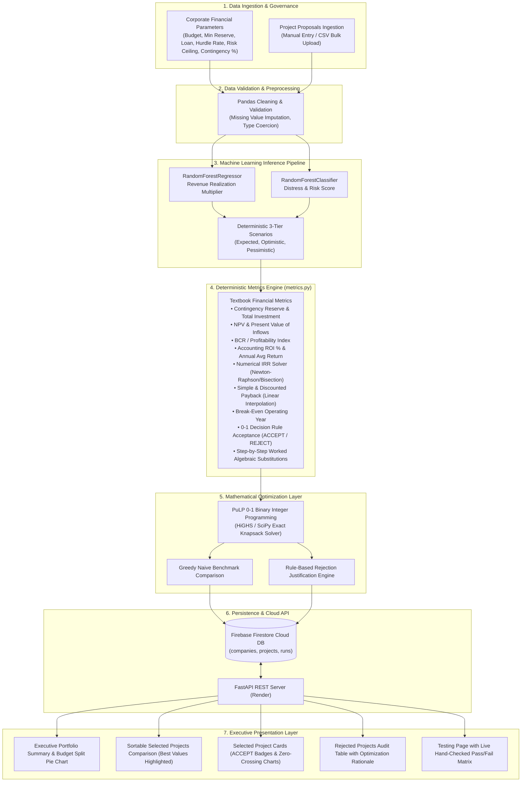

# VentureLens AI — End-to-End System Workflow & Financial Engineering Specification

> **Course**: Foundations of Financial Management (FFM) CIE-2  
> **Topic**: Emerging Technology in Financial Decision-Making — Machine Learning & Mathematical Capital Allocation  
> **Live Web Application**: [https://venture-lens-ai-delta.vercel.app](https://venture-lens-ai-delta.vercel.app)  
> **Live Testing Verification**: [https://venture-lens-ai-delta.vercel.app/testing](https://venture-lens-ai-delta.vercel.app/testing)  
> **Live Production Backend**: [https://ffm-cie-2.onrender.com](https://ffm-cie-2.onrender.com)  
> **Repository**: [https://github.com/Aryan010N/VentureLens_AI](https://github.com/Aryan010N/VentureLens_AI)

---

## 📌 1. Corporate Finance Context & Problem Statement

### The Capital Rationing Dilemma
In modern corporate financial planning, executive committees face a fundamental constraint known as **Capital Rationing**: investment capital is finite, while viable capital expenditure (CapEx) opportunities exceed available funds. 

Under unconstrained capital budgeting, a company simply accepts every project whose **Net Present Value (NPV)** is strictly positive ($\text{NPV} > 0$). However, when a hard budget limit exists, evaluating projects on a standalone basis fails due to three critical structural blind spots:

1. **Greedy Misallocation (The Knapsack Trap)**: Selecting the highest-NPV single project first can exhaust the budget, locking out a combination of smaller, highly efficient projects whose aggregate NPV is significantly greater.
2. **Liquidity & Reserve Breaches**: Projects with attractive multi-year returns may suffer severe negative cash flow deficits in early years, breaching the company's minimum liquidity safety floor.
3. **Portfolio Risk Skew**: High-return standalone projects often carry high downside risk. Independent evaluation risks concentrating exposure beyond corporate tolerance.

### The VentureLens AI Solution
VentureLens AI solves this challenge by integrating **three foundational pillars** into an automated, auditable decision-making platform:
1. **Real Historical Machine Learning**: Predicts risk and revenue confidence based on real Kaggle venture data.
2. **Textbook-Deterministic Financial Metrics Engine (`metrics.py`)**: Computes exact NPV, BCR, ROI %, Annual Average Return %, numerical IRR, simple and discounted payback periods with linear interpolation, and contingency reserves.
3. **PuLP 0-1 Binary Integer Linear Programming**: Solves the global combinatorial knapsack optimization to identify the mathematically optimal portfolio while generating explicit audit rejection reasons for unselected initiatives.

---

## 🏛️ 2. Architectural Blueprint: 0 to Complete

---

## 🔄 3. Step-by-Step Operating Workflow

### Step 0: Corporate Financial Governance & Constraints Setup
The CFO or financial manager establishes corporate capital boundaries:
- **Total Investment Budget**: Maximum available equity capital.
- **Minimum Cash Reserve**: Preserved liquidity buffer that operating balances must never breach.
- **Available Loan Facility**: External credit line available for bridge financing.
- **Hurdle Rate / Cost of Capital ($r$)**: Discount rate reflecting weighted average cost of capital (WACC).
- **Max Acceptable Risk**: Executive portfolio tolerance (`Low`, `Medium`, or `High`).
- **Contingency Reserve %**: Capital buffer added to baseline project costs (default: 10%, 0% for base spec).

### Step 1: Candidate Proposal Ingestion
Candidate initiatives are registered via structured form entry or bulk CSV upload:
- Baseline initial outlay ($\text{Initial Cost}$).
- Multi-year projected gross cash inflows ($[CF_1, CF_2, \dots, CF_n]$).
- Operational duration (years), Industry category, and qualitative risk classification.

### Step 2: Machine Learning Risk & Confidence Inference
The backend executes real trained scikit-learn models on held-out Kaggle venture data:
- **Revenue Realization Factor**: Predicts probability-weighted realization multiplier ($\text{R}^2 = 0.8678$).
- **Distress Probability Classifier**: Classifies operational risk probability ($\text{ROC-AUC} = 0.8176$).
- **Deterministic 3-Tier Scenarios**: Expected ($1.0\times$), Optimistic ($1.2\times$), and Pessimistic ($0.8\times$) projections.

### Step 3: Deterministic Financial Metrics Computation (`metrics.py`)
For **every project** (regardless of selection status), `metrics.py` calculates the comprehensive corporate finance suite:
- Total investment including contingency reserve.
- Discount factors and discounted present value (PV) schedules.
- Net Present Value ($\text{NPV}$), Benefit-Cost Ratio ($\text{BCR}$), ROI %, Average Annual Return %.
- Numerical root-finding Internal Rate of Return ($\text{IRR}$).
- Simple Payback and Discounted Payback using exact linear interpolation within the recovery year.
- Break-even operating year and multi-year cumulative cash flow series starting at $-I_0$.
- 0-1 Decision Rule: $\text{ACCEPT}$ iff $\text{NPV} > 0 \land \text{BCR} > 1.0 \land \text{IRR} > r$, else $\text{REJECT}$.
- Step-by-step algebraic worked substitutions for audit and compliance.

### Step 4: PuLP Binary Integer Linear Programming Optimization
The optimizer evaluates all combinations of candidate projects:
$$\max \sum_{i=1}^n \text{NPV}_i \cdot x_i$$
Subject to:
$$\sum_{i=1}^n \text{Cost}_i \cdot x_i \le \text{Available Budget}$$
$$\text{Portfolio Average Risk} \le \text{Risk Ceiling}$$
$$x_i \in \{0, 1\} \quad \forall i \in \{1, \dots, n\}$$

### Step 5: Executive Results Presentation & Audit Reporting
- **Executive Portfolio Summary**: Top-level KPIs, unallocated liquidity reserve, and budget split pie chart.
- **Sortable Comparison Table**: Ranks selected initiatives with the best value in each column highlighted.
- **Selected Project Cards**: Rich responsive cards displaying ACCEPT badges, 10 metric tiles with tooltips, year-by-year PV schedules, and zero-crossing cumulative cash flow line charts.
- **Rejected Projects Table**: Itemizes unselected initiatives with exact rule-based justifications (`NPV negative`, `Exceeds risk ceiling`, `Budget exhausted`, or `Displaced by higher-yielding combinations`).
- **Testing Page (`/testing`)**: Live pass/fail table verifying the 5 textbook hand-checked cases.

---

## 📐 4. Complete Mathematical Formulas & Rules

### 1. Capital Contingency Reserve & Total Investment
$$\text{Contingency Amount} = \text{Initial Cost} \times \frac{\text{Contingency \%}}{100}$$
$$\text{Total Investment } (I_0) = \text{Initial Cost} + \text{Contingency Amount}$$

### 2. Present Value of Benefits & Discount Factors
For each year $t \in \{1, 2, \dots, n\}$:
$$\text{DF}_t = \frac{1}{(1 + r)^t}$$
$$\text{PV of Benefits} = \sum_{t=1}^n \frac{CF_t}{(1 + r)^t}$$

### 3. Net Present Value (NPV)
$$\text{NPV} = \text{PV of Benefits} - I_0 = \sum_{t=1}^n \frac{CF_t}{(1 + r)^t} - I_0$$
*Decision Hurdle: $\text{NPV} > 0$ to create economic value.*

### 4. Benefit-Cost Ratio (BCR / Profitability Index)
$$\text{BCR} = \frac{\text{PV of Benefits}}{I_0}$$
*Decision Hurdle: $\text{BCR} > 1.0$ indicates capital efficiency.*

### 5. Return on Investment (ROI %) & Average Annual Return
$$\text{Net Benefit} = \sum_{t=1}^n CF_t - I_0$$
$$\text{ROI \%} = \frac{\text{Net Benefit}}{I_0} \times 100$$
$$\text{Average Annual Return \%} = \frac{\text{ROI \%}}{\text{Lifespan}}$$

### 6. Internal Rate of Return (IRR)
The rate $r^*$ where Net Present Value equals zero:
$$\sum_{t=1}^n \frac{CF_t}{(1 + r^*)^t} - I_0 = 0$$
*Solved numerically using Newton-Raphson with bisection fallback; returns `null` if cash flows have no sign change.*

### 7. Simple & Discounted Payback Period (Linear Interpolation)
Let $T$ be the first operating year where cumulative cash flow reaches or exceeds the initial outlay:
$$\text{Payback Period} = (T - 1) + \frac{I_0 - \text{Cumulative Inflow}_{T-1}}{CF_T}$$
*For discounted payback, the identical linear interpolation is applied to the discounted inflow stream $\text{PV}(CF_t)$.*

### 8. Break-Even Operating Year
$$\text{Break-Even Year} = \min \{ t \in \{1, \dots, n\} \mid \text{Cumulative Cash Flow}_t \ge 0 \}$$

---

## 🧪 5. Hand-Checked Unit Test Verification Matrix

All unit tests are codified in [`tests/test_metrics.py`](tests/test_metrics.py) and [`backend/tests/test_metrics.py`](backend/tests/test_metrics.py):

| Test ID | Case Description | Inputs | Expected Hand-Checked Result | Verified Status |
| :---: | :--- | :--- | :--- | :---: |
| **TC-01** | Linear Constant Inflows Payback | Cost: ₹6,00,000, Inflows: ₹1,50,000/yr for 6 yrs | Simple Payback: **4.00 years** | **PASS** |
| **TC-02** | Accounting Profitability & ROI | Cost: ₹10,00,000, Total Profit: ₹2,00,000 | ROI: **20.00%** | **PASS** |
| **TC-03** | Comprehensive Capital Budgeting Case | Cost: ₹10,00,000, Rate: 12%, Inflows: 3, 4, 4, 3, 3 Lakh (Contingency: 0) | Payback: **2.75 years** ($2 + \frac{3}{4}$) NPV: **+₹2,32,330** (+₹2.32L) BCR: **1.232** (~1.23) ROI: **70.0%** IRR: **21.12%** (~21%) Decision: **ACCEPT** | **PASS** |
| **TC-04** | Unrecovered Outlay & Auto-Rejection | Cost: ₹10,00,000, Inflows: ₹1,00,000, ₹1,00,000 | Payback: **null** Decision: **REJECT** | **PASS** |
| **TC-05** | Capital Contingency Impact | 10% Contingency on ₹10,00,000 Cost | Outlay: **₹11,00,000** (+100k) NPV: **₹1,32,330** (lowers by exactly ₹100k) | **PASS** |

---

## 🌐 6. Cloud Deployment & Live Verification

- **Vercel Production Frontend**: [https://venture-lens-ai-delta.vercel.app](https://venture-lens-ai-delta.vercel.app) (Status: **200 OK**)
- **Live Testing Verification Page**: [https://venture-lens-ai-delta.vercel.app/testing](https://venture-lens-ai-delta.vercel.app/testing) (Status: **200 OK**)
- **Render Production Backend**: [https://ffm-cie-2.onrender.com](https://ffm-cie-2.onrender.com) (Status: **200 OK**)
- **Live Test Suite Execution**: [https://ffm-cie-2.onrender.com/api/test-metrics](https://ffm-cie-2.onrender.com/api/test-metrics) (Status: **200 OK**, 5/5 Hand-Checked Cases passing)
- **API Health Check**: [https://ffm-cie-2.onrender.com/api/health](https://ffm-cie-2.onrender.com/api/health) (Status: **200 OK**)

